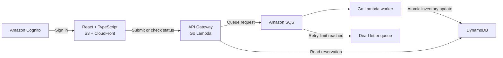

# PokéDrop

Trainers compete to reserve limited Pokémon-style cards during a simulated drop. A React + TypeScript
dashboard shows the catalog and each reservation's outcome; a Go backend on AWS processes reservations
asynchronously and keeps inventory correct under concurrent requests, duplicate submissions and worker
failures.

**The question this project answers:** how do you make sure the last card is reserved exactly once,
even when many trainers ask for it at the same moment and a worker crashes halfway through?

**Live demo:** <https://d1ewiq3l30zml1.cloudfront.net>. Sign up with any email address (Cognito sends
a verification code), then reserve a card. The demo catalog is three fictional cards with small stock,
so it may already be sold out.

| Doc | What is in it |
|---|---|
| [docs/api.md](docs/api.md) | API contract: request and response shapes, statuses, error codes, auth rules, stack outputs |
| [docs/decisions.md](docs/decisions.md) | Every design decision, dated, with the reason, including the corrections |
| [docs/runbook.md](docs/runbook.md) | What to do when an alarm fires: inspect, fix, remove poison messages, replay, verify; plus the recorded drills |
| [docs/benchmark.md](docs/benchmark.md) | Load test results, conditions, the failing run and how to reproduce |
| [docs/PLAN.md](docs/PLAN.md) | The phased plan this was built from, with each phase's verification notes |

## Architecture



- **Frontend:** a Vite SPA, served from a private S3 bucket through CloudFront (origin access control)
  in prod. Sign-in is the Cognito hosted UI with authorization code + PKCE. It reads its API URL and
  Cognito IDs from `/config.json` at startup, so one build works for every stage.
- **API:** an HTTP API with a Cognito JWT authorizer on every route, backed by one Go Lambda
  (`provided.al2023`, arm64). It validates a reservation, sends it to SQS and returns `202 QUEUED`. It
  never writes a table.
- **Worker:** a Go Lambda reading the queue. It turns each request into `CONFIRMED` or `SOLD_OUT` with
  one DynamoDB transaction and reports failed records individually (partial batch responses).
- **Failure handling:** 5 receives, then the dead letter queue. Four CloudWatch alarms (DLQ depth,
  worker ERROR logs, backlog age, worker crashes) email an SNS topic.
- **Infrastructure:** one CDK (TypeScript) app, stacks `pokedrop-<stage>` for `dev`, `test` and `prod`,
  plus `pokedrop-ci` for the GitHub deploy role. CI and deploys run on GitHub Actions.

```text
frontend/          React + TypeScript SPA (Vite, Vitest)
backend/cmd/       api and worker Lambdas; seed, token and drainverify tools
backend/internal/  reservations (rules), storage (DynamoDB), queue (SQS), stackinfo
backend/integration/  acceptance tests against the deployed test stack
infra/             CDK app and its jest tests
tests/load/        k6 burst script
scripts/           ownership fixture and poison message helpers
docs/              plan, API contract, decisions, runbook, benchmark
```

## How it guarantees no overselling and no double reservations

The project's invariants:

1. Stock never goes negative.
2. A repeated request ID never consumes inventory twice.
3. Trainers can read only their own reservations.
4. `POST /reservations` returning `202` means **queued**, not reserved.

**The mechanism.** The client generates a `requestId` (a UUID) per submission and reuses it on every
retry. The worker reserves with one `TransactWriteItems` call holding two items:

- the inventory update, `stock = stock - 1`, with the condition `stock >= 1`, and
- a put of the `CONFIRMED` outcome keyed by trainer + request ID, with the condition
  `attribute_not_exists(requestId)`.

Both happen or neither does. When the transaction is cancelled, the worker checks the reservation item
first: if an outcome already exists it is a duplicate, and the stored outcome is returned without
touching stock. Only when the reservation condition passed and the stock condition failed is the
result `SOLD_OUT`, written with the same `attribute_not_exists` condition, so no write ever overwrites
an outcome and a `CONFIRMED` can never turn into `SOLD_OUT`. Conflicts and throttling are retried
(3 times in-process, then through SQS); because the worker is idempotent per request ID, retrying is
always safe. Reads are keyed by the caller's token `sub`, so another trainer's request ID gives the
same `404` as an unknown one. Details: decisions 24 to 27 in [docs/decisions.md](docs/decisions.md).

**The evidence.**

| Claim | Evidence |
|---|---|
| No oversell under contention | **100 CONFIRMED + 100 SOLD_OUT** from 200 unique requests for 100 copies of one card, final stock 0, no request ID with two rows, DLQ empty: run `full-c2` on `pokedrop-test` ([benchmark](docs/benchmark.md#headline)). Also `TestOversell` and the DynamoDB Local concurrency tests. |
| One decrement per request ID | `TestDuplicates` (5 concurrent copies, then a later one: one row, stock −1) and the DynamoDB Local duplicate tests |
| A crash after commit does not reserve twice | `TestFailureAfterCommit` on `pokedrop-test`, and the Phase 5 drill on `pokedrop-dev`: one request failed on purpose after committing, was redelivered 60 s later as `duplicate: true`, stock moved once ([runbook drills](docs/runbook.md#drill-results)) |
| A poison message ends in the DLQ and pages | Phase 5 drill on `pokedrop-dev`: 5 failed receives 60 s apart, then the DLQ; both alarms fired and emailed. A committed request in the DLQ was sorted from the poison message and replayed: one decrement over 6 deliveries ([runbook](docs/runbook.md#drill-results)) |
| Results are private | `TestCrossTrainerRead`: trainer B gets the same `404` for A's request as for an unknown ID |

Measured on `pokedrop-test` (2026-11-10), with a laptop as the load generator: submit latency p50
43.7 ms, p95 107 ms; 95% of outcomes within the 1 s resolution of `updatedAt`; one request took 60 s
(see the limits below). The conditions and the **failing first run** are in
[docs/benchmark.md](docs/benchmark.md).

## Setup from a fresh clone

**Prerequisites:** Go (version in `backend/go.mod`), Node.js 22, GNU Make, Docker (for the DynamoDB
Local tests). For deploying: AWS CLI v2 with a profile named `pokedrop` in region `us-west-2`. For load
tests: k6.

**Offline build and tests** (no AWS needed, this is what CI runs):

```sh
git clone https://github.com/arunPdl02/pokedrop.git && cd pokedrop
make install        # npm ci in infra/ and frontend/
make test           # gofmt, go vet, go test, CDK jest tests, Vitest; builds the Lambdas and the SPA
make test-local     # concurrency tests against DynamoDB Local in Docker
```

**Deploy a dev stack.** Sign in first (on `ExpiredToken`, sign in again):

```sh
aws login --profile pokedrop
export ALARM_EMAIL=you@example.com            # alarm emails; synth refuses to run without it
cd infra && npx cdk bootstrap --profile pokedrop && cd ..   # once per account and region
cd infra && npx cdk diff pokedrop-dev -c stage=dev && cd .. # review the IAM and resource changes
make deploy                                   # from an interactive terminal; CDK asks before IAM changes
make seed                                     # the three demo cards
```

Confirm the SNS subscription from the email AWS sends. `make deploy` needs a terminal on purpose: CDK
refuses to apply IAM or security group changes without confirmation, and nothing here passes
`--require-approval never`.

**Run the frontend locally against dev:**

```sh
make frontend-config            # writes frontend/public/config.json (git-ignored) from the stack outputs
cd frontend && npm run dev      # http://localhost:5173, the only origin dev's Cognito client accepts
```

**Test user for curl and the integration tests:** create `.env.local` (git-ignored) with
`TEST_USER_EMAIL` and `TEST_USER_PASSWORD` (see `.env.example`). `make token` creates that user on first
use through a dev-only app client and prints an access token. It refuses `prod`, which has no such
client.

**Prod and the deploy pipeline** (what the live demo runs on):

```sh
cd infra && npx cdk diff pokedrop-prod -c stage=prod && cd ..
make deploy STAGE=prod          # S3 + CloudFront site, prod tables (RETAIN), the CloudFront URL in Cognito and CORS
make seed STAGE=prod            # once: re-running resets stock under existing reservations
cd infra && npx cdk diff pokedrop-ci -c stage=prod && cd ..
make deploy-ci                  # the GitHub OIDC provider and the deploy role, by hand, once
```

Then set the repository secrets `AWS_ACCOUNT_ID` and `ALARM_EMAIL`, and protect `main` (pull request
and the `test` and `dynamodb-local` checks required). From then on every push to `main` runs the tests
and deploys `pokedrop-prod` through the role. The role trusts only this repository's `main` branch.
The deploy uses `--require-approval broadening`, so a change that adds IAM permissions fails in CI: it
is deployed by hand from its branch after reviewing the diff, before merging.

`make seed` writes every card unconditionally, so it **resets stock**; it never touches reservations.
Use it on a fresh stack. `make seed STOCK=100` sets every card to 100 (load tests).

## API examples

The full contract is in [docs/api.md](docs/api.md). Against dev, with the `make token` user:

```sh
TOKEN=$(make -s token)
API=$(aws cloudformation describe-stacks --profile pokedrop --region us-west-2 --stack-name pokedrop-dev \
  --query "Stacks[0].Outputs[?OutputKey=='ApiUrl'].OutputValue" --output text)
RID=$(uuidgen 2>/dev/null || cat /proc/sys/kernel/random/uuid)

curl -s -H "Authorization: Bearer $TOKEN" "$API/cards"
# {"cards":[{"cardId":"card-001","name":"Ember Drake","rarity":"rare","available":6}, ...]}

curl -s -X POST -H "Authorization: Bearer $TOKEN" -H 'Content-Type: application/json' \
  -d "{\"requestId\":\"$RID\",\"cardId\":\"card-001\"}" "$API/reservations"
# 202 {"requestId":"…","status":"QUEUED"}      queued, not reserved

curl -s -H "Authorization: Bearer $TOKEN" "$API/reservations/$RID"
# 404 {"error":{"code":"RESERVATION_NOT_FOUND",…}}   not processed yet: keep polling
# 200 {"requestId":"…","cardId":"card-001","status":"CONFIRMED","updatedAt":"…"}
```

Sending the same `requestId` again is safe: it may be queued again, but it never takes a second card.
Requests without a token get `401`; an ID token instead of the access token gets `403`.

## Tests

| Command | What it runs | Needs |
|---|---|---|
| `make test` | gofmt and `go vet`, Go unit tests, CDK assertion tests (IAM statements, trust policy, removal policies, CORS), Vitest frontend tests; builds the Lambdas and the SPA | nothing (offline) |
| `make test-local` | Concurrency and duplicate tests against DynamoDB Local 3.3.2 in a throwaway container | Docker |
| `make test-integration STAGE=test` | Acceptance rows 1, 2 and 5 against the deployed `pokedrop-test` stack (oversell, duplicates, cross-trainer reads) | deployed test stack |
| `make test-integration-failure STAGE=test` | Acceptance row 3: failure after commit (after `make fail-on STAGE=test MODE=once`) | deployed test stack |
| `make load STAGE=test RUN=… REQUESTS=… CONCURRENCY=…` | k6 burst; a preflight refuses a concurrency the account's Lambda limit cannot take | k6, test stack |
| `make drain-verify STAGE=test RUN=… STOCK=…` | Waits for the queue to drain, checks the invariants, prints the benchmark numbers | test stack |

The integration and load targets reset stock and only run with `STAGE=test`. The full sequence is in
[docs/benchmark.md](docs/benchmark.md#reproduce). CI (`.github/workflows/ci.yml`) runs `make lint`,
`make test`, `make build`, a `cdk synth` of dev and prod with no AWS credentials, and the DynamoDB Local
tests in a service container, on every push and pull request.

## Operations

When an alarm email arrives or reservations stay `QUEUED` (the UI shows **Delayed**), follow
[docs/runbook.md](docs/runbook.md): inspect the worker logs, fix the cause, delete poison messages,
replay the rest from the DLQ, then verify stock and reservations. It also records the three drills it
was tested with. `make fail-on MODE=once|always` (dev and test only) makes the worker fail after
committing, to practice it.

## Tradeoffs and known limits

- **Polling, not push.** The UI polls `GET /reservations/{requestId}` with increasing intervals for up to
  60 s, then shows **Delayed** (never sold out). WebSockets or SSE would be quicker but add a connection
  service for a result that usually arrives in under a second.
- **A small catalog.** Three cards, one card per reservation, and `GET /cards` is a table scan, which is
  fine for three items and not for a real catalog.
- **Hot-key contention.** Every reservation for one card updates the same DynamoDB item. In the clean
  benchmark, 1 request of 200 lost the transaction on all 3 in-process attempts, went back to SQS and
  waited the full **60 s visibility timeout**, which was the whole 60 s maximum and drain time. Rare,
  but expensive when it happens ([finding 2](docs/benchmark.md#finding-2-one-conflicted-message-waits-a-full-minute)).
- **A load concurrency cap of 2, found empirically.** The account's Lambda limit of 10 is shared by the
  API and the worker. The first sizing rule allowed 4 in flight and was throttled (194 of 200
  accepted); halving it gave a clean run. The cause of the throttling is not known, so 2 is a measured
  margin, not a derived one.
- **One-second timing resolution.** `updatedAt` is stored in whole seconds, so time to final outcome
  cannot be measured below about 1 s.
- **Open sign-up on the demo.** Anyone can create a trainer account. Cognito's default email sender caps
  at about 50 messages a day, and there is no API throttling. A budget alert is the cost guard.
- **One shared Lambda limit.** dev, test and prod share the account's 10 concurrent executions, so heavy
  use of one stage can throttle the others.
- **The pipeline is admin-equivalent.** The default CDK bootstrap gives CloudFormation an
  AdministratorAccess execution role, so whoever can merge to `main` can change anything in the
  account through the deploy. The OIDC role is narrow, the trust is pinned to `main`, `main` is
  protected and IAM growth needs a manual deploy, but a tighter execution policy needs re-bootstrapping
  (decision 66).
- **No TLS 1.2 floor.** CloudFront ignores a minimum TLS version on its default `*.cloudfront.net`
  certificate; a floor needs a custom domain and certificate.
- **The managed policy remains on CDK's own helpers.** The API and worker roles can write only to their
  own log groups, but the deploy-time helper Lambdas that CDK adds in prod (site upload, bucket
  auto-delete) keep `AWSLambdaBasicExecutionRole`.

## Teardown

**dev** uses `RemovalPolicy.DESTROY`, so this deletes the tables, queues, user pool (with its users) and
logs:

```sh
cd infra && npx cdk destroy pokedrop-dev -c stage=dev --profile pokedrop
```

**test** is `make destroy STAGE=test` (it refuses any other stage). A recreated stack gets new Cognito
IDs and a new hosted UI domain, so re-run `make frontend-config` and update
[docs/api.md](docs/api.md#stack-outputs).

**prod** keeps its data when the stack is deleted. Not executed: the demo is still running.

1. Stop the pipeline first, or the next push to `main` redeploys it: `gh workflow disable deploy.yml`.
2. Note the physical names of the retained resources:
   `aws cloudformation list-stack-resources --stack-name pokedrop-prod --profile pokedrop --region us-west-2`.
3. `cd infra && npx cdk destroy pokedrop-prod -c stage=prod --profile pokedrop`. The site bucket and
   distribution are deleted; these are **retained** (`DeletionPolicy: Retain` in the template):
   - DynamoDB tables `InventoryTable` and `ReservationsTable`
   - the Cognito user pool `AuthUserPool`, with every trainer account
   - SQS queues `ReservationQueue` and `ReservationDlq`
   - log groups `ApiLogs` and `WorkerLogs`
4. Delete those by name with the AWS CLI once you are sure the data is no longer needed.
5. `cd infra && npx cdk destroy pokedrop-ci -c stage=prod --profile pokedrop` removes the deploy role
   and the GitHub OIDC provider (unless it was reused with `-c githubOidcProviderArn`). Then delete the
   `AWS_ACCOUNT_ID` and `ALARM_EMAIL` repository secrets.

Every `cdk` command synthesizes the app, so `ALARM_EMAIL` must be set for these too. None of this
removes the shared `CDKToolkit` bootstrap stack, its bucket, or the account's AWS Budget.

## How I used AI

I built this with Claude Code as a pair programmer, and the repository records how. `CLAUDE.md` gives
it the invariants, the git rules and the AWS rules, and `docs/PLAN.md` splits the work into phases.
For each phase it proposed a plan and wrote no code until I approved it. It could read AWS and run
`cdk diff`, but every deploy was mine: I read each diff's IAM and resource changes and ran the deploy
from my own terminal. Its permissions also kept it out of `.env*` files and IAM reads. Each decision
went into `docs/decisions.md` as it was made, with the reason, and each new test was checked by
breaking the code it covers and watching it fail (decision 49).

The useful lesson came from where that review was not enough. **`SafeConcurrency`** (decision 48): the
AI-written rule for how many load requests the account could take said 4, and its unit tests passed
because they encoded the same arithmetic. The first real burst got throttled, 194 of 200 requests were
accepted, and the run ended 100 + 94 instead of 100 + 100. I kept that failing run in the benchmark,
halved the cap, and recorded one clean run at 2 rather than rerunning until something passed. The
**OIDC trust policy** (decision 67) was the same pattern: the role trusted the name-based subject, its
tests checked that exact string, and GitHub actually issues an immutable, ID-based subject for this
repository, so the first deploy was refused. Smaller ones were caught by reading what CDK generated
rather than trusting the source: a TLS 1.2 minimum that CloudFront silently ignores (decision 58), and
the alarm email address leaking into a logical ID that the public deploy logs would print (decision 60).

What I take from it: tests written by the same author as the code share its assumptions, so they
confirm the arithmetic, not the premise. For anything that depends on the outside world (account
limits, an identity provider's token format, what a service actually accepts), the claim is only true
once a real run against the real system has tried to break it, and the failures stay in the record.

## License

[MIT](LICENSE)
