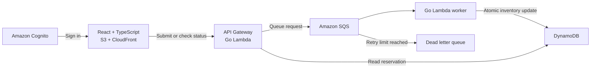

# PokéDrop — Implementation Plan

Trainers compete to reserve limited collectible cards during simulated drops. A React + TypeScript dashboard shows cards and reservation outcomes; a Go backend on AWS processes reservations asynchronously and protects inventory under concurrent requests and message retries.

**Core question:** How do we ensure the last available card is reserved only once, even when many trainers request it and a worker fails halfway through processing?

## Scope (first release)

- Three card listings, one card per reservation
- One AWS region: **us-west-2**, profile `pokedrop`
- Authenticated trainer dashboard; the workflow ends with a reservation outcome

## Architecture



Infrastructure: AWS CDK (TypeScript). CI/CD: GitHub Actions. Observability: CloudWatch.

## Invariants (never violate)

1. Inventory never becomes negative.
2. A repeated request ID never consumes inventory twice.
3. Trainers can access only their own reservations.
4. `POST /reservations` returning 202 means **queued**, not reserved.

## Endpoints (full contract in docs/api.md)

| Endpoint | Responsibility |
|---|---|
| `GET /cards` | Return the catalog and current availability |
| `POST /reservations` | Validate and queue a reservation |
| `GET /reservations/{requestId}` | Return the caller's reservation outcome |

## Repository layout

```text
pokedrop/
  frontend/
  backend/
    cmd/api/
    cmd/worker/
    internal/reservations/
    internal/storage/
  infra/
  tests/load/
  scripts/
  docs/
```

---

## Phase 1 — Repository and system contract (est. 1–1.5 h)

- [x] Create workspaces for frontend, backend, infra, tests, scripts and docs
- [x] Initialize TypeScript (strict), Go modules, formatting, lockfiles and `.gitignore`
- [x] Keep reservation rules in `backend/internal/`, separate from Lambda handlers
- [x] Write `docs/api.md` (request/response shapes, statuses, error codes, auth rules)
- [x] CDK app: stack tags (`project=pokedrop`), 1-week log retention, DynamoDB tables for inventory and reservations (PAY_PER_REQUEST, RemovalPolicy.DESTROY in dev)
- [x] Seed script for three fictional cards (`make seed`)
- [x] Makefile targets: `build`, `test`, `deploy`, `hotswap`, `seed`
- [x] Budget alert confirmed; README teardown instructions

**Commits**
- [x] `chore: initialize frontend backend and infrastructure workspaces`
- [x] `feat: provision development resources and seed card inventory` (committed as `feat: provision development resources` and `feat: seed card inventory`, one logical change each)

**Milestone**
- [x] The repository builds, dev resources deploy, and the catalog seeds reproducibly

---

## Phase 2 — Authentication and reservation API (est. 2–3 h)

- [ ] Cognito user pool with hosted sign-in; app client using authorization code + PKCE; callback/logout URLs for `http://localhost:5173`
- [ ] Separate dev-only app client allowing `ADMIN_USER_PASSWORD_AUTH`
- [ ] HTTP API with JWT authorizer (required scopes) and CORS for `http://localhost:5173`
- [ ] Trainer identity derived from the validated token's `sub` claim
- [ ] Go API Lambda (`provided.al2023`, arm64) using AWS SDK for Go v2
- [ ] Reservation = client-generated `requestId` (UUID) + `cardId`; frontend reuses the same ID on retry
- [ ] `POST /reservations` returns **202 only after SQS accepts the message**
- [ ] `GET /cards` and `GET /reservations/{requestId}`, scoped to the authenticated trainer
- [ ] `make token`: create a dev test user if missing and print a token (password from `.env.local`)
- [ ] Stack outputs needed by the frontend recorded in `docs/api.md`

**Commits**
- [ ] `feat: authenticate trainers and validate reservation requests`
- [ ] `feat: enqueue reservations and expose catalog and status endpoints`

**Milestone**
- [ ] Unauthenticated requests get 401
- [ ] An authenticated request reaches SQS; invalid requests are rejected
- [ ] Reservation reads enforce ownership

> After Phase 2: run Phase 4 in a parallel worktree (`phase-4-frontend`) that edits only `frontend/`.

---

## Phase 3 — Inventory correctness and duplicate handling (est. 1–1.5 h)

- [ ] Inventory records keyed by card ID; reservation results keyed by trainer ID + request ID
- [ ] Worker Lambda consumes SQS
- [ ] One DynamoDB `TransactWriteItems`:
  - [ ] Decrement stock only if stock ≥ 1
  - [ ] Put confirmed reservation only if no outcome exists for that request (`attribute_not_exists`)
- [ ] Duplicate message → return existing outcome without changing inventory
- [ ] Retain outcome records through the retry/replay window
- [ ] Insufficient stock → `SOLD_OUT` as a normal terminal outcome
- [ ] Transaction conflicts, throttling and transient errors classified as retryable
- [ ] Unit tests for the logic; concurrency test against DynamoDB Local

**Commits**
- [ ] `feat: reserve card inventory with conditional transactions`
- [ ] `test: verify duplicate and concurrent reservation handling`

**Milestone**
- [ ] Repeating one request leaves one reservation and one inventory decrement
- [ ] Exhausting stock produces `SOLD_OUT`, never negative stock

---

## Phase 4 — Trainer dashboard (est. 2–3 h, parallel worktree)

- [ ] React + TypeScript + Vite in `frontend/`
- [ ] Cognito hosted sign-in (PKCE) and authenticated API calls
- [ ] Three card listings with quantities, reserve button and reservation status
- [ ] One request ID per submission, reused across network retries
- [ ] Accepted request IDs kept in localStorage so a refresh can still check them
- [ ] Bounded polling with increasing intervals; a timeout is never shown as sold out
- [ ] States displayed:

  | State | Meaning |
  |---|---|
  | Queued | The API accepted the request for processing |
  | Confirmed | The worker recorded a successful reservation |
  | Sold out | The worker recorded insufficient inventory |
  | Delayed | Processing exceeded the normal polling window (UI-only) |

- [ ] Vitest tests: submission, duplicate clicks, status updates, API errors

**Commits**
- [ ] `feat: build trainer catalog and sign in flow`
- [ ] `feat: display reservation progress and outcomes`

**Milestone**
- [ ] A trainer can sign in, reserve a card, and see the persisted result

---

## Phase 5 — Failure recovery and operational visibility (est. 1.5–2 h)

- [ ] SQS retries (`maxReceiveCount`), dead letter queue, visibility timeout ≥ 6× worker timeout
- [ ] Partial batch responses (`ReportBatchItemFailures`)
- [ ] Structured logs: requestId, cardId, outcome, duration
- [ ] CloudWatch alarms: queue backlog age, DLQ messages, worker errors → SNS email
- [ ] Dev-only failure flag that throws **after the transaction commits, before returning success**
- [ ] `docs/runbook.md`: inspect error → fix cause → replay messages → verify inventory and reservations

**Commits**
- [ ] `feat: configure retries dead letter queue and monitoring`
- [ ] `test: verify worker recovery and document message replay`

**Milestone**
- [ ] A forced post-commit failure retries without creating a duplicate reservation
- [ ] A poison message reaches the DLQ and triggers an alarm

---

## Phase 6 — Correctness and performance (est. 2–3 h)

- [ ] Go unit tests for validation and error classification
- [ ] Integration tests against an isolated `test` stack
- [ ] k6 scripts for authenticated bursts (configurable card and request counts)
- [ ] Drain-and-verify script that checks inventory and reservation counts
- [ ] Acceptance tests (run small first: 10 cards / 20 requests):

  | Scenario | Required result |
  |---|---|
  | 100 cards, 200 unique requests | 100 confirmed + 100 sold out after settling |
  | Repeated copies of a successful request | One reservation, one decrement |
  | Worker failure after commit | Retry preserves original outcome and inventory |
  | Permanently failing message | Reaches DLQ and triggers monitoring |
  | Trainer requests another trainer's result | 404 (result concealed) |

- [ ] `docs/benchmark.md`: p50/p95 submit latency, time to final outcome, throughput, errors, queue drain time, workload size, concurrency, region, config
- [ ] Review AI-generated code against the tests; record one concrete correction in `docs/decisions.md`
- [ ] Destroy the `test` stack afterwards

**Commits**
- [ ] `test: cover reservation outcomes authorization and failure paths`
- [ ] `perf: add reproducible load tests and benchmark report`

**Milestone**
- [ ] The repository contains measured, reproducible evidence for its reliability claims

---

## Phase 7 — Delivery automation and packaging (est. 2–3 h)

- [ ] CI workflow: gofmt, go vet, go test, tsc, vitest, builds on every push
- [ ] Deploy workflow on `main` via GitHub OIDC; IAM role defined in CDK, trusted only for this repo's `main` branch
- [ ] Application roles limited to the resources and actions they need
- [ ] Frontend deployed to a private S3 bucket behind CloudFront (OAC); CloudFront URL added to Cognito callbacks and CORS
- [ ] README: setup, architecture, API examples, test commands, benchmark results, recovery steps, tradeoffs (polling, small catalog, hot-key contention on a popular card), teardown
- [ ] Secret scan before going public; `.env.local` never committed
- [ ] 2–3 minute demo: normal reservation, competing burst, duplicate handling, worker recovery

**Commits**
- [ ] `ci: deploy tested application builds through scoped AWS roles`
- [ ] `docs: document architecture benchmarks recovery and demonstration`

**Milestone**
- [ ] A reviewer can open the app, inspect the code, reproduce the tests, and understand the decisions

---

## Final portfolio package

- [ ] Deployed demo
- [ ] Public repository
- [ ] Passing tests
- [ ] Reproducible benchmark report
- [ ] Recovery walkthrough
- [ ] Resume bullets updated with measured results

## References

- [API Gateway JWT authorizers](https://docs.aws.amazon.com/apigateway/latest/developerguide/http-api-jwt-authorizer.html)
- [Go on Lambda](https://docs.aws.amazon.com/lambda/latest/dg/lambda-golang.html)
- [DynamoDB transactions](https://docs.aws.amazon.com/amazondynamodb/latest/developerguide/transactions.html)
- [Lambda with SQS](https://docs.aws.amazon.com/lambda/latest/dg/with-sqs.html)
- [SQS error handling and partial batch responses](https://docs.aws.amazon.com/lambda/latest/dg/services-sqs-errorhandling.html)
